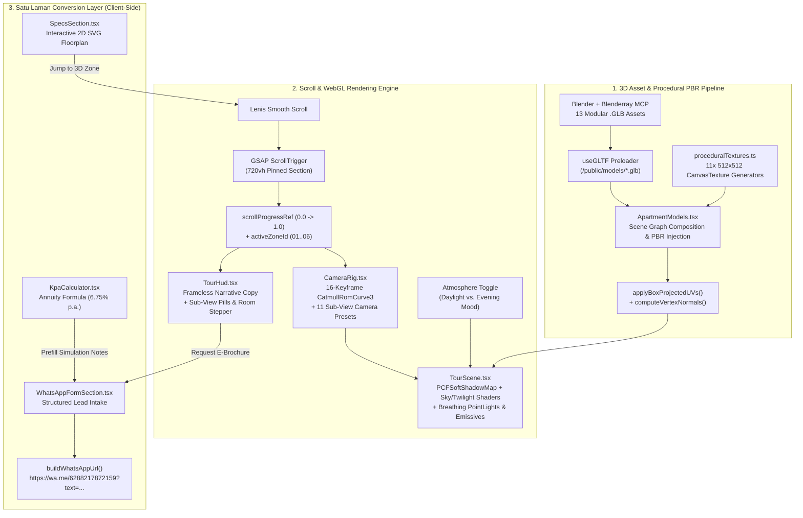

# Verdant Sky Residence — Interactive 3D Scroll Unit Tour

> *1-Bedroom Japandi Modern Luxury (48 m²) WebGL Virtual Tour & Conversion-Focused Property Showcase.*

[](#1-project-overview--satu-laman-governance)
[](#3-system-architecture--data-flow)
[](https://react.dev/)
[](https://r3f.docs.pmnd.rs/)
[](https://www.typescriptlang.org/)
[](https://tailwindcss.com/)
[](./LICENSE)

---

## 1. Project Overview & Satu Laman Governance

**Verdant Sky Residence** (*Tower A — Tipe 1-Bedroom Japandi Modern Luxury, 48 m²*) is a flagship WebGL interactive property showcase engineered to demonstrate how real-time 3D spatial storytelling and high-converting property lead generation can coexist inside a single lightweight web application.

> [!IMPORTANT]
> **Portfolio & Concept Demo Disclosure:**
> This repository is an **Interactive 3D Concept Demo / Portfolio Showcase** built upon the **Satu Laman** architectural framework (*One Page. Complete Business Experience*). It is not an active commercial sale listing. All conversion actions operate 100% client-side via a structured **M3 Inquiry + WhatsApp Handoff** pipeline (`https://wa.me/6288217872159?text=...`) with zero backend database, zero payment gateway, and zero server lock-in.

### Design Philosophy
- **Editorial Frameless Typography:** Narrative copy renders directly over the 3D viewport with a subtle atmospheric gradient vignette—free of heavy HUD boxes or bento-grid clutter—using an architectural palette of warm off-white (`#F5F2EB`), charcoal (`#18181B`), travertine/oak (`#A88B68`), and WhatsApp green (`#25D366`) reserved strictly for conversion CTAs.
- **Spatial Narrative First:** Visitors experience the apartment's proportions, ceiling height (`3.2 m`), natural daylighting, and material transitions firsthand by scrolling from the entrance door all the way out to the private sky balcony.

---

## 2. Key Features

### 2.1 Scroll-Driven 3D Unit Tour (`720vh` Container)
- **Piecewise-Synchronized `CatmullRomCurve3` Camera Rail:** Driven by **Lenis** smooth scrolling and **GSAP ScrollTrigger**, the camera interpolates seamlessly across 16 spatial keyframes spanning all **6 sequential architectural zones**:
  1. **01 / 06 · Entrance Foyer (`0% – 15%`):** Solid oak entrance door, integrated smart lock, vertical oak slats, arch mirror, and concealed shoe bench.
  2. **02 / 06 · Pantry & Island Dining (`15% – 30%`):** Calacatta marble countertop, induction cooktop, travertine dining island, and dual woven teak basket pendant lamps (`lampugantung.glb`).
  3. **03 / 06 · Living Sanctuary (`30% – 50%`):** Wide diagonal sweep framing the plush white shearling/fur lounge sofa (`sofa.glb`), organic oak coffee table, sculptural stacked-disc floor lamp (`lampumeja.glb`), and wall-mounted TV on a travertine feature backing panel.
  4. **04 / 06 · Master Bedroom (`50% – 70%`):** Smooth doorway entry revealing the walnut/oak platform bed with sage quilted duvet and plump linen pillows (`bed.glb`), bedside globe pendants, wall-mounted bedroom smart TV, and open oak hotel wardrobe (`lemari.glb`) with brushed brass clothes rail and safe.
  5. **05 / 06 · En-Suite Bathroom (`70% – 78%`):** Physical camera entry *inside* the bathroom doorway showcasing the floating travertine vanity, backlit round LED mirror, wall-hung toilet, frameless walk-in rain shower, and brushed nickel towel bar with draped terry towels (`towel.glb`).
  6. **06 / 06 · Private Sky Balcony (`78% – 100%`):** Two-stage exterior choreography—**Part A (`78%–88%`)** steps through the sliding glass doors toward the azure daytime sky, drifting cumulus clouds, and city skyline; **Part B (`88%–100%`)** glides to the outer balcony corner and executes a **150° reverse panorama turn** looking back across both **Burgundy (`#6B1D2F`)** woven lounge chairs, travertine side table, planters, WPC wood decking, and the glowing apartment interior through the glass facade.

### 2.2 Interactive Sub-View Camera Angles & 3D Hotspots
- **Room Stepper (`01 Foyer` – `06 Balcony`):** Frameless bottom typographic tabs allow instant smooth-scroll jumps to any room.
- **11 Dedicated Sub-View Camera Presets:** Context-aware angle pills appear per zone (*Sudut Lebar Ruang Tamu*, *Fokus Sofa & Meja*, *Fokus TV & Media Console*, *Fokus Kasur & Bantal*, *Isi Lemari Wardrobe*, *Area TV Kamar*, *Masuk ke Kamar Mandi →*, *Wastafel & Cermin LED*, *Area Walk-In Shower*, *Panorama Skyline Kota*, and *Reverse View: Lounge Burgundy & Jendela*). Physical wheel/touch scrolling automatically releases the sub-view lock back to the main scroll rail.
- **Dynamic 3D `<Html>` Hotspot Pins:** Runtime scene-graph bounding-box traversal (`Box3.setFromObject`) anchors interactive material detail popovers to `Hotspot_SmartLock`, `Hotspot_MarbleCounter`, `Hotspot_AcousticGlass`, and `Hotspot_SkyBalcony` with coordinate fallbacks.

### 2.3 Dynamic Daylight vs. Evening Mood Lighting Engine
- **Daylight Mode (`ACESFilmicToneMapping`, Exposure `0.92`):**
  - Restrained ambient (`0.28`) and hemisphere (`0.35`) fill paired with a primary warm-white directional sun (`intensity: 2.6`, `#FFF5E4`, `2048×2048` `PCFSoftShadowMap`, `shadow-bias: -0.0006`, `shadow-normalBias: 0.035`) casting crisp window-mullion and furniture shadows across the oak floor without white overexposure.
  - Custom GLSL `DaylightSkyDome` shader (`#CBE4F9` horizon to `#2E6FE6` zenith with solar halo), 12 drifting procedural cumulus cloud layers (`DaylightClouds`), and exponential atmospheric haze (`<fogExp2 args={['#CFE3F5', 0.009]} />`).
- **Evening Mood (Exposure `1.05`):**
  - Custom GLSL `TwilightSkyDome` (`#090D16` to `#1E293B`), 1,500 fading `<Stars />`, and cool moonlight directional fill (`#3B82F6`, `0.25`).
  - Warm architectural interior `PointLight` pools (`#FFBE73` / `#FFCA80` / `#FFC87A`) and emissive lamp materials (`#F5D299` / `#F6D296`) animated with multi-harmonic organic breathing waves (`pendant` and `table-lamp` profiles), alongside procedural skyscraper window grids (`emissiveIntensity: 2.4`).

### 2.4 Runtime Procedural PBR Material & Geometry Enhancement
- **Zero External Texture Files Required:** `src/utils/proceduralTextures.ts` generates 11 deterministic `512×512` `CanvasTexture` maps in memory using a seeded PRNG:
  - `skylineMap` & `skylineEmissiveMap` (curtain-wall glass mullions + randomized `#FDE68A` warm amber & `#E0F2FE` cool white office windows, with dark-clamped rooftop UVs).
  - `limewashBump` & `limewashRoughness` (troweled mineral plaster walls `#F3EFE6`).
  - `oakMap` & `oakRoughness` (longitudinal wood grain & plank seams).
  - `linenWrinkleBump` & `fabricBump` (undulating drapery folds + crisp warp/weft linen weave).
  - `furFleeceMap` & `furFleeceBump` (9,500+ micro-fur tuft strokes + shearling bouclé clusters for the white living room sofa).
  - `wovenRopeBump` (braided outdoor rope & cushion texture for the `#6B1D2F` Burgundy balcony lounge chairs).
  - `marbleMap` & `marbleRoughness` (Calacatta & travertine mineral veins).
  - `cloudPuffTexture` (multi-lobe feathered cumulus cloud sprite).
- **Tri-Planar Box-Projected UV Generator (`applyBoxProjectedUVs`) & Normal Smoothing (`computeVertexNormals`):** Automatically computes clean UV coordinates and smooth vertex normals for meshes exported without `TEXCOORD_0`.

### 2.5 Conversion Layer (KPA Mortgage Simulator & WhatsApp Handoff)
- **Interactive 2D SVG Floorplan & Technical Specs (`SpecsSection.tsx`):** Clickable room zones on the 2D architectural schematic jump directly to the corresponding 3D camera waypoint.
- **Real-Time KPA Annuity Calculator (`KpaCalculator.tsx`):** Switch between Studio (`32 m²` · `Rp980.000.000`) and 1-Bedroom (`48 m²` · `Rp1.450.000.000`), adjust Down Payment (`10%–50%`), and select loan tenor (`5, 10, 15, 20 years` at `6.75%` fixed promotional rate).
- **Structured WhatsApp Handoff (`WhatsAppFormSection.tsx` & `FloatingWhatsApp.tsx`):** Encodes visitor name, inquiry purpose, preferred viewing schedule, and KPA simulation summary directly into a formatted Bahasa Indonesia WhatsApp deep link.

---

## 3. System Architecture & Data Flow



---

## 4. Project Directory Structure

```text
verdant-sky-residence/
├── index.html                          # Entry HTML (Cormorant Garamond & Plus Jakarta Sans fonts)
├── package.json                        # Dependencies & scripts (React 19, Three.js, R3F, GSAP, Lenis)
├── tsconfig.json                       # Strict TypeScript configuration
├── vite.config.ts                      # Vite 6 + React + Tailwind CSS v4 plugin configuration
├── LICENSE                             # MIT License (Copyright 2026 Ahmad Syafii / Satu Laman Studio)
├── README.md                           # Project documentation
├── public/
│   ├── favicon.svg                     # Brand favicon
│   └── models/                         # 13 Modular 3D glTF/GLB assets
│       ├── 00-apartment-shell.glb      # Architectural walls, oak floor, ceiling coffer & bronze glazing
│       ├── 01-foyer.glb                # Entrance door, smart lock, oak slats, mirror & shoe cabinet
│       ├── 02-kitchen.glb              # Calacatta marble counter, cabinets, induction stove & island
│       ├── 03-living.glb               # Coffee table, wool rug, sheer curtains, media console & TV
│       ├── 04-bedroom.glb              # Nightstands, globe pendants, area rug, vanity desk & chair
│       ├── 05-bathroom.glb             # Travertine vanity, backlit mirror, toilet & walk-in rain shower
│       ├── 06-balcony-skyline.glb      # WPC deck, glass railing, lounge chairs, planters & city skyline
│       ├── bed.glb                     # Walnut/oak platform bed with sage quilted duvet & linen pillows
│       ├── lampugantung.glb            # Woven teak basket pendant lamp with warm opal diffuser bulb
│       ├── lampumeja.glb               # Sculptural brass floor/table lamp with stacked offset diffusers
│       ├── lemari.glb                  # Open oak hotel wardrobe with brass rail, folded linen & safe
│       ├── sofa.glb                    # Lounge sofa upgraded at runtime with white fluffy fur texture
│       └── towel.glb                   # Brushed nickel wall towel bar with warm grey & white terry towels
└── src/
    ├── main.tsx                        # React 19 DOM root mount
    ├── App.tsx                         # Lenis + GSAP ScrollTrigger orchestration & state management
    ├── index.css                       # Tailwind CSS v4 directives, custom typography & keyframe animations
    ├── data/
    │   └── tourData.ts                 # 6 Tour zones, 11 SubViewIds, 4 3D hotspots, KPA options & WA builder
    ├── utils/
    │   └── proceduralTextures.ts       # 512x512 CanvasTexture generators & tri-planar box-projected UVs
    └── components/
        ├── Preloader.tsx               # Drei useProgress() 0%–100% architectural preloader overlay
        ├── Navbar.tsx                  # Adaptive sticky editorial header with CONCEPT DEMO badge
        ├── TourHud.tsx                 # Frameless storytelling copy, atmosphere toggle, sub-view pills & stepper
        ├── SpecsSection.tsx            # Architectural metrics, material specs & clickable 2D SVG floorplan
        ├── KpaCalculator.tsx           # Interactive mortgage (KPA) simulator with WhatsApp handoff trigger
        ├── WhatsAppFormSection.tsx     # Client-side consultation & viewing booking form + live WA preview
        ├── FloatingWhatsApp.tsx        # Persistent bottom-right quick WhatsApp CTA button
        └── three/
            ├── TourScene.tsx           # R3F Canvas, Sky/Twilight GLSL domes, drifting clouds & shadow lights
            ├── CameraRig.tsx           # 16-keyframe CatmullRomCurve3 scroll camera + 11 sub-view presets
            └── ApartmentModels.tsx     # Multi-GLB scene assembly, PBR texture injection & emissive breathing
```

---

## 5. Tech Stack

| Layer | Technology | Version | Purpose |
| :--- | :--- | :--- | :--- |
| **Core Framework** | React + TypeScript | `19.1.0` / `~5.8.2` | Component architecture & strict type safety across 3D/UI state |
| **Build Tool** | Vite | `^6.2.6` | Fast HMR development server & optimized production bundling |
| **3D Engine** | Three.js | `^0.175.0` | WebGL rendering, `PCFSoftShadowMap`, `ACESFilmicToneMapping`, GLSL shaders |
| **React 3D Bridge** | `@react-three/fiber` | `^9.1.2` | Declarative Three.js scene graph & `useFrame` render loop |
| **3D Helpers** | `@react-three/drei` | `^10.0.8` | `useGLTF`, `Html`, `Environment`, `Lightformer`, `ContactShadows`, `Stars`, `useProgress` |
| **Scroll & Motion** | GSAP (`ScrollTrigger`) + Lenis | `^3.12.7` / `^1.2.3` | Silky-smooth inertial scrolling synced with 3D camera progress |
| **Styling & Icons** | Tailwind CSS + Lucide React | `^4.1.3` / `^0.487.0` | Editorial Japandi HUD styling, responsive grid & minimalist line icons |
| **3D Asset Pipeline** | Blender + Blenderray MCP | `glTF 2.0 (.glb)` | Modular architectural & furniture modeling exported to binary glTF |

---

## 6. Workflow (End-to-End Development & User Journey)

### Part A — 3D-to-Web Production Workflow
1. **Modular 3D Asset Generation (Blender + Blenderray MCP):** Architectural shell (`00-apartment-shell.glb`), room zones (`01` through `06`), and hero furniture/lighting pieces (`bed.glb`, `lampugantung.glb`, `lampumeja.glb`, `lemari.glb`, `sofa.glb`, `towel.glb`) are authored as modular `.glb` assets so individual fixtures can be swapped or refined without re-exporting the entire apartment.
2. **Runtime Scene Composition (`ApartmentModels.tsx`):** All 13 `.glb` scenes are preloaded via `useGLTF.preload`, cloned safely with isolated material instances, and composed at world origin `[0, 0, 0]`.
3. **Procedural PBR & Shader Injection (`proceduralTextures.ts`):** On mount, meshes are traversed to compute smooth vertex normals, generate tri-planar box-projected UVs where needed, and inject `512×512` procedural bump, roughness, albedo, and emissive textures—keeping total asset download size compact while achieving rich close-up surface detail.
4. **Prompt-Driven Development (PDD) in Antigravity IDE:** Camera spline choreography, shadow bias tuning, multi-harmonic lamp breathing curves, and conversion copy are iteratively verified against live WebGL renders.

### Part B — User Experience Flow
```text
[0%–100% Smart GPU Preloader]
       │
       ▼
[Hero Viewport (01 Entrance Foyer)] ──► Toggle Daylight / Evening Mood at any time
       │
       ▼  (Lenis Smooth Scroll / Room Stepper Tabs)
[Guided 6-Zone 3D Spatial Tour]     ──► Click (+) 3D Material Hotspots
  01 Foyer ➔ 02 Kitchen ➔ 03 Living ──► Click Sub-View Angle Pills (TV, Sofa, Bed,
  ➔ 04 Bedroom ➔ 05 Bathroom            Wardrobe, Shower, Skyline, 150° Reverse Balcony)
  ➔ 06 Balcony & Reverse Panorama
       │
       ▼
[Technical Specifications & Interactive 2D SVG Floorplan]
       │
       ▼
[Interactive KPA Mortgage Simulator] ──► Prefills Unit, DP %, Tenor & Monthly Installment
       │
       ▼
[Structured WhatsApp Handoff Form]   ──► Redirects to https://wa.me/6288217872159?text=...
```

---

## 7. Getting Started (Local Installation & Build)

### Prerequisites
- **Node.js** `v18+` (tested on `v24.15.0`) and **npm**.

### 1. Clone & Install Dependencies
```bash
git clone https://github.com/brovynrecho01/verdant-sky-residence.git
cd verdant-sky-residence
npm install
```

### 2. Run the Development Server
```bash
npm run dev
```
Open **[http://localhost:5173/](http://localhost:5173/)** in your browser.

### 3. Typecheck & Build for Production
```bash
npm run build
```
This runs `tsc -b && vite build` and outputs the optimized production bundle to `dist/`.

### 4. Preview Production Build Locally
```bash
npm run preview
```

---

## 8. License & Credits

- **Source Code License:** Licensed under the **[MIT License](./LICENSE)** — Copyright (c) 2026 **Ahmad Syafii (Satu Laman Studio)**.
- **Concept & Branding Notice:** While the source code, procedural texture generators, and R3F camera/lighting architecture are licensed under the MIT License, the *Verdant Sky Residence* concept branding, architectural layout, and showcase copy are created for portfolio demonstration and educational reference under the **Satu Laman** framework.

### Author & Architect
**Ahmad Syafii** (`@brovynrecho01`)  
*AI System Architect & Creative Engineer — Satu Laman Studio*
